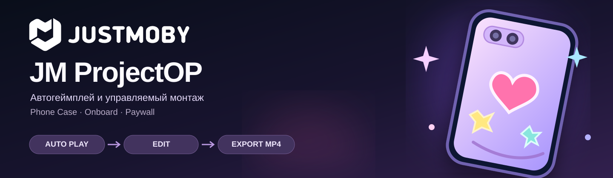

<div align="center">



# JM ProjectOP

**Автогеймплей и управляемый монтаж для onboard и paywall**

Автоматическое прохождение мини-игры Phone Case, событийный монтаж и экспорт роликов из редактируемого проекта.

`Phone Case` · `Autoplay` · `Event-driven editing` · `Onboard` · `Paywall` · `H.264` · `30 FPS`

**Статус: концепция и подготовка MVP. Реализация ещё не начата.**

</div>

## О проекте

JM ProjectOP — планируемая утилита для сборки видеокреативов на основе согласованных ассетов **Phone Case**. Пользователь выбирает чехол, цвета, рисунки, наклейки и сценарий. Бот воспроизводит действия, записывает материал вместе с событиями, а монтажная система отбирает и собирает эпизоды в понятный ролик.

**Ключевой принцип:** итогом является **редактируемый проект**, а MP4 создаётся по запросу. Замена ассетов после монтажа должна вызывать повторный рендер затронутых сцен без ручного восстановления структуры ролика.

## Основной процесс

```text
Ассеты + настройки
        ↓
Сценарий (UI / текстовая инструкция)
        ↓
Проверка и подтверждение монтажного плана
        ↓
Автопрохождение мини-игры Phone Case
        ↓
События + состояния + действия + запись
        ↓
Отбор и монтаж эпизодов
        ↓
Редактируемый проект → предпросмотр → MP4
                         ↘ пакетные варианты
```

## Функции запланированного MVP

- **Автогеймплей:** очистка → рисование → наклейки → демонстрация готового чехла, без действий человека.
- **Сценарии:** настройка порядка этапов, длительности, чехлов, рисунков, наклеек, скорости; интерпретация текстовой инструкции с предпросмотром плана и проверкой ограничений.
- **Осмысленный монтаж:** выбор по явным событиям, правилам и инструкции, сокращение ожидания и неинформативных перемещений.
- **Повторяемость:** сохранение исходного состояния, параметров, действий бота, таймкодов и зависимостей; воспроизведение дубля и диагностика зависаний.
- **Неразрушающее редактирование:** замена доступных ассетов, цветов, фона, масштаба и положения объектов с адресной перегенерацией несовместимых эпизодов.
- **Циклы:** резкий стык (cut loop) или плавное бесшовное замыкание, без чёрного кадра.
- **Экспорт:** MP4 / H.264 / 30 FPS; проверка сейвзон; пакетная сборка вариантов.

## Форматы и сейвзоны

| Пресет | Полный кадр | Отступы | Безопасная область |
| --- | --- | --- | --- |
| **Onboard** | 1124 × 1124 px | 150 px со всех сторон | 824 × 824 px |
| **Paywall** | 1124 × 1000 px | 200 px по бокам; 185 px сверху и снизу | 724 × 630 px |

Сейвзоны масштабируются пропорционально при изменении выходного разрешения. В предпросмотре показываются направляющие. Для paywall учитывается возможность освободить композиционное место под кнопку закрытия.

## Документация

- [Архитектура приложения (предложение v0.1)](docs/ARCHITECTURE.md)
- [Инструкции разработчикам и ИИ-агентам](AGENTS.md)
- [Предлагаемые технологические решения (ADR-0001)](docs/decisions/ADR-0001-foundation-proposal.md)
- [Полное продуктовое и функциональное ТЗ](docs/PRODUCT_SPEC.md)
- [Этапы разработки и критерии приёмки](docs/ROADMAP.md)
- [Правила безопасной работы с проектом](SECURITY.md)
- [Лицензия и ограничения использования](LICENSE)

## Лицензия и права

**Proprietary / All rights reserved.** Наличие исходных файлов в репозитории **не** означает разрешения использовать, копировать, изменять, распространять или коммерциализировать проект. См. [LICENSE](LICENSE). Права на сторонние ассеты, в том числе ресурсы Phone Case, остаются у их правообладателей.

> ⚠️ Рекомендуемый режим хранения исходников — **private repository** с доступом только участникам проекта. Условия лицензирования не являются технической защитой от копирования.

© 2026 danilloskutnikov-design. All rights reserved.
